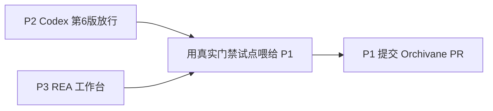

# 截图内容项目梳理

> 依据两张界面截图整理：一是 Grok Bot 对 **Orchivane** 仓库的分析与贡献建议；二是多 Agent 协作工作台中 **Codex 第 6 版** 审核与 **REA 逆向工程** 执行现场。  
> 下文拆成 **3 个可独立推进的完整项目**，彼此有协作关系，可按优先级并行或串行落地。

---

## 总览

| 项目 | 类型 | 核心目标 | 建议负责人（角色） | 优先级 |
|------|------|----------|--------------------|--------|
| P1 Orchivane × Grok Bot 落地与回馈 | 技能/流程引入 + 开源贡献 | 把 Orchivane 工作流落成 Grok Bot Skill，并以「大冰」名义提交 PR | 首席执行官统筹；审核官把关；技术官实现 | 高 |
| P2 Codex 第 6 版候选包核验与放行 | 版本发布门禁 | 对 41 文件候选包做 md5/diff/测试核验，按时完成审核与推送 | 技术官交付；审核官验收；内务部/运营署跟进 | 高 |
| P3 REA 逆向工程项目研发工作台 | 多 Agent 专项 R&D | 加载 REA、打通 MCP 工具链，在指定聊天页分发与执行任务 | 中控总部调度；情报官/技术官执行 | 中 |

**跨项目共性约束（来自 Orchivane / 当前团队规范对齐）：**

1. 一个交付物只设一个负责人。  
2. 状态必须分句、可核验：`做完了` / `测过了` / `推上去了` / `上线了`，禁止一句话糊弄。  
3. 「冰哥同意了」等口头转述不算授权；须有明确可追溯确认。  
4. 临近发布节点禁止加新功能，只修必改项与 diff 核验。

---

## 项目一：Orchivane × Grok Bot 落地与回馈

### 1.1 背景与问题

截图一显示用户希望：

- 把某仓库（分析结论为 **Orchivane**）当作 Grok Bot 的插件/能力来用；
- 以笔名 **「大冰」** 向该项目提交 PR，成为贡献者。

Grok Bot 的结论要点：

- Orchivane **不是**可直接安装的 Grok Bot 插件，而是面向 **Codex / Claude Code** 的一套 **Skill（技能文档）**：1 份总说明 + 7 个章节说明。
- 理念是「一个中控 + 多个专精 Agent」，与当前侧栏里的 CEO / 技术官 / 审核官等建制同构。
- 版本 **0.4.1**，近期更新，**MIT License**。
- 在 Grok Bot 侧正确用法是：把文档落成 **Skill**，而不是装成独立软件。
- 作者只收「真实使用结果」类 PR，不欢迎纯错别字修补；仓库目前仅有 Codex / Claude Code 指南，**缺 Grok Bot 实现指南**——这正是高价值贡献切入点。

### 1.2 目标（Done 定义）

- [ ] 将 Orchivane 核心文档整理并保存为 Grok Bot 可用 Skill（可复用、可被任意助手加载）。
- [ ] 审核官完成 Skill 内容审核，并按 Orchivane 状态词分别登记。
- [ ] 团队日常协作采用其门禁规则（单一负责人、分状态汇报、禁止口头授权）。
- [ ] 基于真实跑通记录，撰写《Grok Bot 实现指南》并准备 PR。
- [ ] 以「大冰」身份向 Orchivane 上游提交 PR（内容为使用报告 + Grok Bot 指南，非无关润色）。

### 1.3 范围

**包含：**

- 文档抽取、去平台化改写、Skill 落盘与命名；
- 试点：用 Skill 跑通 1～2 个真实任务（建议挂靠 P2 或 P3）；
- 贡献材料：使用过程、差异、适配步骤、截图/日志摘要；
- GitHub 账号与身份「大冰」的贡献说明（若需）。

**不包含：**

- 把 Orchivane 改造成独立 MCP 插件安装包（除非后续另立项）；
- 为通过 PR 而伪造使用数据。

### 1.4 角色与职责

| 角色 | 职责 |
|------|------|
| 首席执行官（Grok Bot） | 定优先级、验收 Skill 与 PR 材料是否「真实使用」达标 |
| 审核官 | 审 Skill 与贡献文稿；禁止「口头授权」放行 |
| 技术官 | 文档结构化、Skill 编写、试点跑通、PR 分支与 diff |
| 情报官 | 跟踪上游 0.4.x 变更与作者贡献规范 |
| 法商官 | MIT 合规与署名「大冰」的对外表述确认 |

### 1.5 里程碑与状态门禁

| 里程碑 | 状态词（须单独确认） | 产出 |
|--------|----------------------|------|
| M1 文档入库 | 做完了 | Skill 初稿 + 章节映射表 |
| M2 审核通过 | 测过了 | 审核官批注关闭；试点任务日志 |
| M3 指南定稿 | 做完了 / 测过了 | 《Grok Bot 实现指南》+ 使用证据包 |
| M4 上游合入 | 推上去了 | PR 链接；若合入则记「上线了」 |

### 1.6 交付物清单

1. `skills/orchivane-grok-bot/SKILL.md`（及必要章节文件）  
2. 《Orchivane 与现有 Agent 建制对照表》  
3. 《Grok Bot 实现指南》（拟作为上游 PR 正文）  
4. 试点任务记录（输入、步骤、结果、失败与规避）  
5. PR 草稿：标题、说明、文件变更列表  

### 1.7 风险

| 风险 | 应对 |
|------|------|
| 上游拒绝「仅文档」PR | 先完成真实试点再提；在 PR 中附可复现步骤 |
| Skill 与 Codex/Claude 路径差异过大 | 指南中单列「平台差异」章节，不强行 1:1 拷贝指令 |
| 身份「大冰」与账号不一致 | 法商官确认署名与 Git 作者信息策略 |

### 1.8 下一步（可立刻执行）

1. 打开 Orchivane 仓库最新 0.4.1 文档，做章节目录映射。  
2. 审核官立标准：哪些条款必须进团队 SOP。  
3. 选定一个试点任务（推荐：Codex 第 6 版状态汇报模板）。  

---

## 项目二：Codex 第 6 版候选包核验与放行

### 2.1 背景与问题

截图二显示团队正在推进 **Codex 第 6 版**：

- 候选包：`第6版_候选包_源码可核_1647.zip`  
- 规模：约 **41** 个文件；附带 **md5**、**diff**、新增测试等可核材料  
- 技术官称三处「必改项」已落实；强调本阶段 **不加新功能**，以免拖期  
- 审核官确认第 6 版进入可审状态  
- 时间节点提及：**北京时间约 19:00**（截图语境中关联 10/28 07:00 一类时间戳，落地时以当时约定为准）  
- 涉及 Swift / iOS 等相关改动检查  

侧栏同时存在「中控总部 / Skills / 插件 / 指令」与多业务线（网站、设计、APP、音视频等），第 6 版是当前技术主线之一。

### 2.2 目标（Done 定义）

- [ ] 候选包完整性校验通过（文件数、md5、与声明一致）。  
- [ ] diff 范围仅含约定必改项 + 必要测试，无夹带功能。  
- [ ] 审核官出具可放行结论（书面，非口头）。  
- [ ] 推送与上线状态分别登记：`推上去了` → `上线了`。  

### 2.3 范围

**包含：** 解包核验、md5 对照、diff 审阅、回归测试执行与记录、放行决策、版本标注。  
**不包含：** 新需求开发、非必改重构、跨业务线（设计/音视频等）需求塞入本包。

### 2.4 角色与职责

| 角色 | 职责 |
|------|------|
| 技术官 | 出包、md5/diff/测试说明、修必改项、按时点交付 |
| 审核官 | 独立核验；给出「测过了」或打回清单 |
| 首席执行官 | 裁是否允许破例加项；最终「上线了」确认 |
| 内务部 / 运营署 | 发布节奏、通知各业务线兼容性 |
| 学习官 | 沉淀第 6 版变更说明供后续培训 |

### 2.5 核验清单（建议原样进 SOP）

1. **包完整性**：文件数 = 41（或与清单一致）；每个文件 md5 可复算。  
2. **变更边界**：diff 仅对应「三处必改」+ 声明内测试；无无关文件。  
3. **平台相关**：Swift / iOS 改动有对应测试或手工核验记录。  
4. **门禁话术**：禁止用「冰哥看过了」代替审核官结论。  
5. **状态拆分**：做完了 ≠ 测过了 ≠ 推上去了 ≠ 上线了。  

### 2.6 里程碑

| 里程碑 | 状态词 | 产出 |
|--------|--------|------|
| 候选包冻结 | 做完了 | zip + 文件清单 + md5 表 |
| 审核关闭 | 测过了 | 审核报告 / 打回单 |
| 合入主干或发布通道 | 推上去了 | 提交/发版记录 |
| 生产可用 | 上线了 | 对外版本号与回滚点 |

### 2.7 交付物清单

1. `第6版_候选包_源码可核_1647.zip` 及解包工作区  
2. `CHECKSUMS.md`（路径 → md5）  
3. `DIFF_SUMMARY.md`（必改三项对照）  
4. `TEST_REPORT.md`  
5. `RELEASE_GATE.md`（审核官签字栏：测过了 / 打回）  

### 2.8 风险

| 风险 | 应对 |
|------|------|
| 超时（约 19:00 节点） | 超时只允许缩范围，不允许加功能 |
| 夹带改动 | 审核官按文件白名单拒收 |
| 用量告警（截图显示剩余约 8%） | 大包分析改走本地/批处理，避免反复烧额度 |

### 2.9 下一步

1. 技术官贴出三处必改的精确描述与对应 diff 锚点。  
2. 审核官按清单跑一轮「测过了」门禁。  
3. 首席执行官确认是否进入「推上去了」。  

---

## 项目三：REA 逆向工程项目研发工作台

### 3.1 背景与问题

截图二「中控总部」侧可见专项：

- **【REA 逆向工程项目研发】**  
- 关联：【多 Agent 协作工程】、【Harness 工作台】、【Loop Engineering 循环工程】、【Harness 外联部】  
- 执行日志出现：加载 REA、校验当前路径配置、**MCP 工具**分析完成、耗时约数分钟级任务、询问「派发到哪个聊天页」  

说明 REA 不是单次问答，而是 **可加载、可分发、依赖工具链** 的持续研发项目。

### 3.2 目标（Done 定义）

- [ ] REA 配置在约定路径可被稳定加载。  
- [ ] MCP 工具连接结果可复现、有记录。  
- [ ] 明确默认派发聊天页与升级路径（中控 → 专项 Agent）。  
- [ ] 产出第一份可交付的逆向分析报告模板（含负责人与状态词）。  

### 3.3 范围

**包含：** 环境加载、工具连通性、任务分发协议、分析报告模板、与 Harness/Loop 的接口约定。  
**不包含：** 未授权目标的逆向；超出合规边界的利用类工作。

### 3.4 角色与职责

| 角色 | 职责 |
|------|------|
| 中控总部 | 任务调度、选择聊天页、汇总 MCP 结果 |
| 技术官 | 工具链、配置、自动化脚本 |
| 情报官 | 输入材料、外部情报整理 |
| 审核官 | 合规与结论可信度把关 |
| 顾问团 / 法商官 | 边界与对外表述 |

### 3.5 工作流（建议固化为 Skill 片段）

```text
接收任务 → 确认负责人（唯一）
  → 加载 REA + 检查配置路径
  → 跑 MCP / 工具连通性自检
  → 选定聊天页派发
  → 产出分析草稿
  → 审核官：测过了 / 打回
  → 推上去了（归档到约定库）
  → 上线了（若对外或对业务线生效）
```

### 3.6 交付物清单

1. `REA_LOAD_CHECKLIST.md`（路径、依赖、自检命令）  
2. `MCP_CONNECTIVITY_LOG.md`  
3. `DISPATCH_MATRIX.md`（任务类型 → 聊天页 / Agent）  
4. `REPORT_TEMPLATE.md`（结论、证据、风险、下一步）  
5. 与 P1 对齐：若 Orchivane Skill 落地，将本流程收编为其中一章  

### 3.7 风险

| 风险 | 应对 |
|------|------|
| 多聊天页派发混乱 | 强制 DISPATCH_MATRIX；禁止口头改派 |
| 工具失败无记录 | 每次自检写日志，失败不得标「做完了」 |
| 与 Codex 第 6 版抢资源 | 首席执行官定窗口；额度紧张时 REA 让路给放行门禁 |

### 3.8 下一步

1. 中控总部公布「默认派发页」与紧急改派规则。  
2. 技术官提交一份最小可加载配置与自检结果。  
3. 选一个小样本跑通「做完了 → 测过了」闭环。  

---

## 组织与界面上下文（两图共性，供项目引用）

### 已出现的 Agent / 部门（不完全列表）

- 首席执行官（Grok Bot）  
- 技术官、审核官、学习官、生活官、生产官、情报官、创意官、法商官  
- 【董事会】【内务部】【运营署】【顾问团】  
- 业务线目录：网站开发、设计、平面、APP、音频、视频、小程序、文案办公、编剧等  

### 平台线索

- 界面为中文深色工作台；存在「连接应用」、用量剩余提示（约 8%、按周重置一类文案）。  
- 协作形态接近「中控 + 多专精 Agent」，与 Orchivane 设计一致——这是 P1 能快速对齐的原因。  

---

## 建议执行顺序



1. **先稳 P2**：有明确包与时间点，适合立刻套用「分状态汇报」。  
2. **并行轻量推进 P3**：打通加载与派发，但额度紧时给 P2 让路。  
3. **用 P2/P3 的真实日志完成 P1**：满足上游「真实使用」门槛，再以「大冰」提 PR。  

---

## 附录 A：状态词典（全项目强制）

| 状态 | 含义 | 谁有权宣布 |
|------|------|------------|
| 做完了 | 负责人声明实现/撰写完成 | 该交付物唯一负责人 |
| 测过了 | 独立核验通过 | 审核官（或书面指定验收人） |
| 推上去了 | 已进入共享仓库/发布通道 | 技术官或发布角色 |
| 上线了 | 对使用者或生产环境生效 | 首席执行官或书面授权人 |

禁止合并表述示例：「都弄好了」「冰哥没意见」「差不多能发」。

---

## 附录 B：文档修订

| 版本 | 日期 | 说明 |
|------|------|------|
| 0.1 | 2026-11-05 | 根据两张截图初稿，拆分为 P1/P2/P3 完整项目 |

